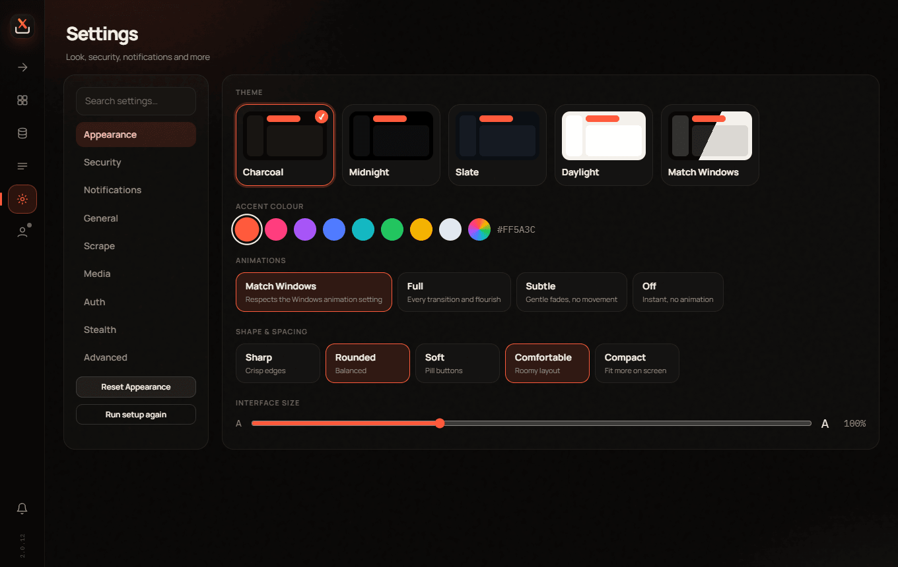
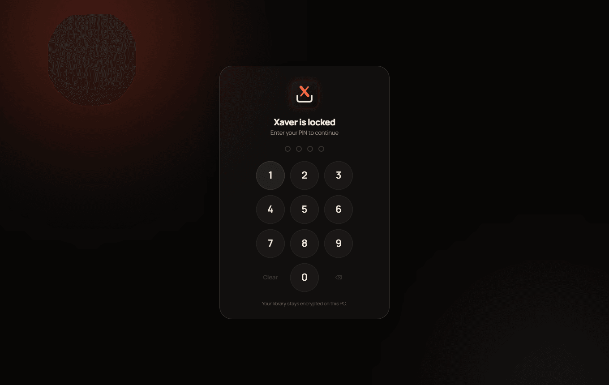
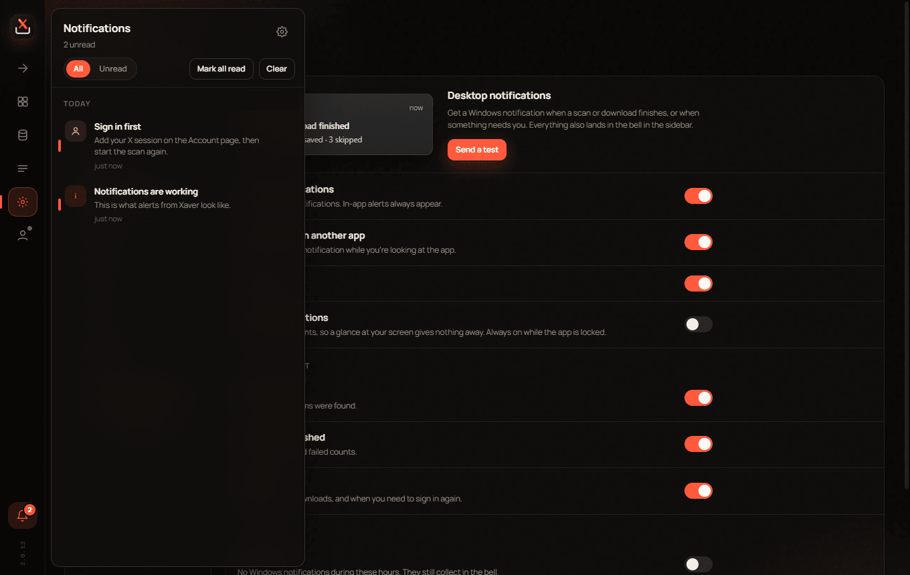
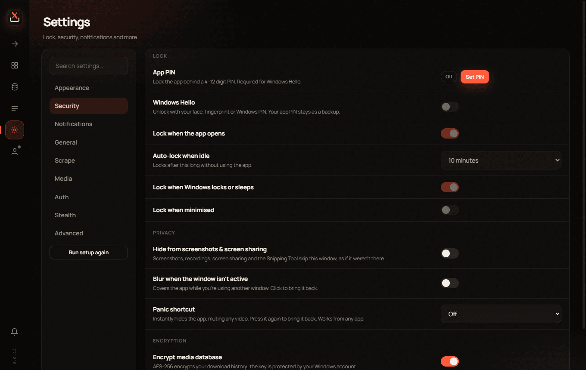
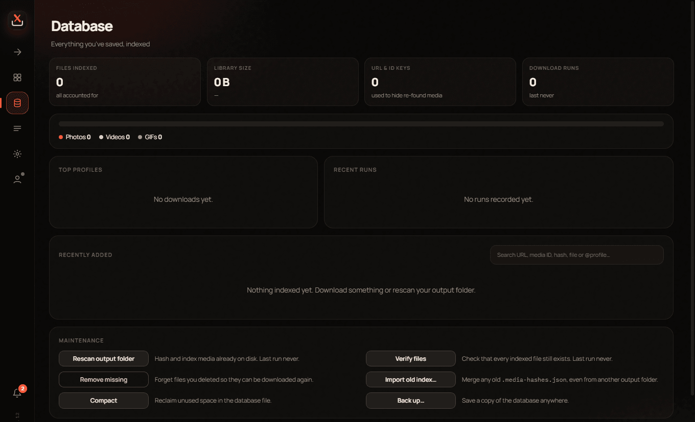

<p align="center">
  
</p>

<h1 align="center">Xaver</h1>

<p align="center">A Windows desktop app for saving photos, videos and GIFs from X profiles.</p>

<p align="center">
  <a href="https://github.com/COMPLEXWASTAKEN/xaver/actions/workflows/ci.yml"></a>
  <a href="https://github.com/COMPLEXWASTAKEN/xaver/actions/workflows/release.yml"></a>
</p>

<p align="center">
  
</p>

## What it does

Point it at a profile (yours or anyone's) and it scrolls through media, posts, reposts, replies, likes or highlights and collects everything it finds into a gallery. Pick what you want and save it to disk, or save the lot.

- **Never saves the same thing twice.** Every file is hashed and kept in a local SQLite database, so media you already have is hidden from the gallery and skipped on download.
- **Real browser, real session.** Scans run through ShardX, an anti-detect Chromium build, with your own X login.
- **App lock.** Optional PIN or Windows Hello, with auto-lock when idle, when Windows locks, or when the app is minimised.
- **Privacy tools.** Hide the window from screenshots and screen sharing, blur it when you switch away, or press a panic shortcut to hide it instantly.
- **Encrypted at rest.** Settings, your session, job history, notifications and the media database are encrypted with Windows data protection and AES-256.
- **Notifications.** Windows notifications and an in-app history for finished scans, downloads and anything that needs you, with quiet hours and a private mode.
- **Themes.** Five themes, any accent colour, animation levels and a first-run setup.

| | |
|---|---|
|  |  |
|  |  |

## Getting started

You'll need Windows 10 or 11 and Node 18 or newer.

```bash
npm install
npm run dev
```

On first launch the app downloads the ShardX browser. Then open **Account**, sign in to X in the window that appears, and start a scan from the **Scan** page. You can also import a cookie export instead; see [docs/cookies.example.txt](docs/cookies.example.txt) for the format.

## Building

```bash
npm run dist
```

This type-checks and builds the app, obfuscates it, packages it, builds the custom installer and checks that it installs and uninstalls cleanly. The result lands in `dist/` as `Xaver Setup <version>.exe`.

The installer is a small WPF app in [`installer/`](installer) and needs the [.NET SDK](https://dotnet.microsoft.com/download) to build. Use `npm run dist:dir` to skip it and get an unpacked app.

| Command | What it does |
|---|---|
| `npm run dev` | Run with hot reload |
| `npm run typecheck` | Type-check everything |
| `npm run build` | Build into `out/` |
| `npm run dist` | Full release: app, installer, checks |
| `npm run dist:dir` | Unpacked app only, no installer |
| `npm run icons` | Regenerate icons from `build/icon.svg` |
| `npm run cli` | Terminal scanner that reads a cookie file |
| `npm run release` | Bump the version, tag it and push, which publishes a release |

## Releases

Every push and pull request is built and verified on GitHub Actions. Each push to `main` also updates the **Latest build** pre-release on the Releases page, so the newest installer is always one click away.

To publish a release:

```bash
npm run release            # 2.0.12 -> 2.0.13
npm run release -- minor   # 2.0.12 -> 2.1.0
npm run release -- 2.2.0-beta.1
```

This checks that `main` is clean and up to date, bumps the version, commits, tags and pushes. The tag starts the **Release** workflow, which builds and verifies the installer, then publishes a GitHub Release with the setup file, checksums and notes made from the commits since the last tag. Versions with a suffix like `-beta.1` are marked as pre-releases. You can also start a release from the Actions tab and type a version.

## Project layout

```
electron/
  main/        app process: window, IPC, jobs, notifications, security, storage
  preload/     the bridge the UI talks to
  shared/      types used on both sides
src/           scraping engine: browser, scraping, downloads, media database
ui/            React interface: app shell, components, views, styles
installer/     custom Windows installer (C# / WPF)
scripts/       build, packaging and release tooling
```

## Where your data lives

- Settings, session, PIN, notifications and the media database are stored in `%APPDATA%\Xaver`. Installs upgraded from the old Profile Media Saver keep using their existing folder.
- Downloads go to `Documents\Xaver` by default. You can change this in **Settings → General**.
- The app talks to X, to ShardX once to download its browser, and to Google Fonts for the interface typeface. Nothing else.

## Security

See [SECURITY.md](SECURITY.md) for how the app is hardened and how to report a problem.

## A note on comments

There are no code comments in this repository, and that's on purpose. The code is meant to explain itself through clear names, small functions and a folder structure that says where things live. If something is hard to follow without a comment, that's treated as a sign the code needs reworking, not annotating.

## Use responsibly

Only save media you have the right to save, and respect X's terms and the people who post there. This project isn't affiliated with or endorsed by X Corp.

## License

Proprietary. All rights reserved. See [LICENSE](LICENSE).
