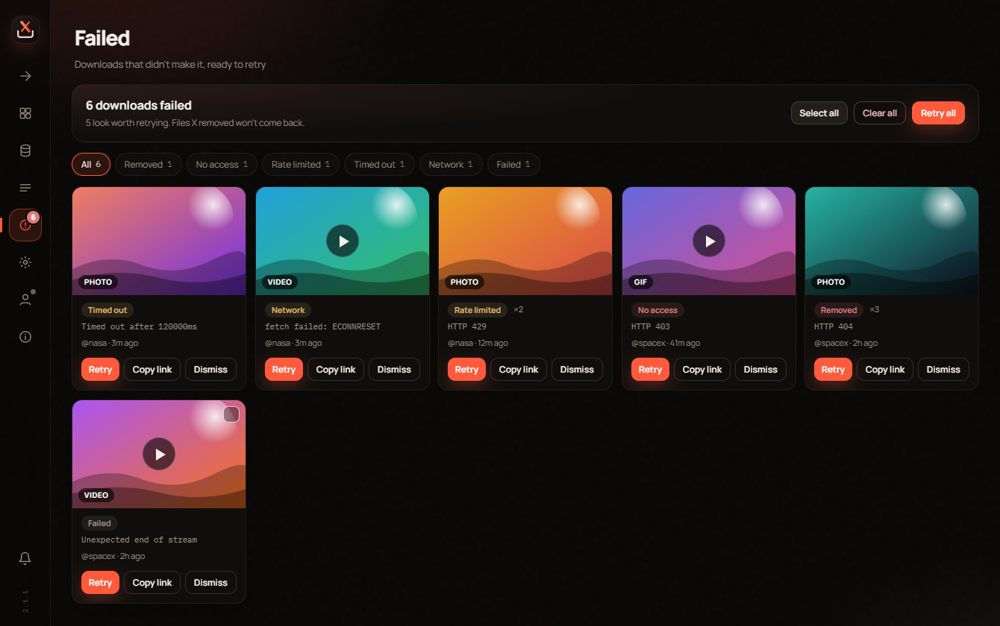
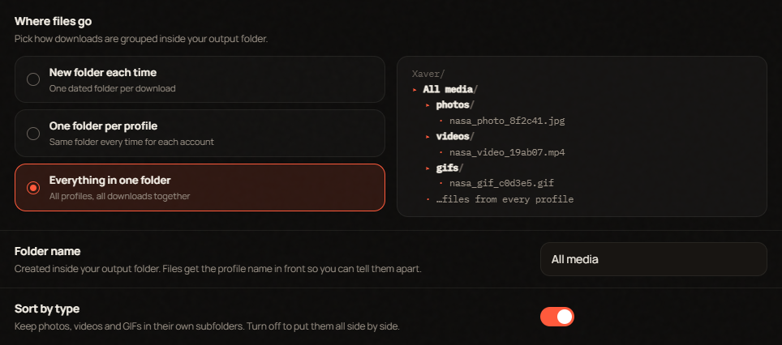
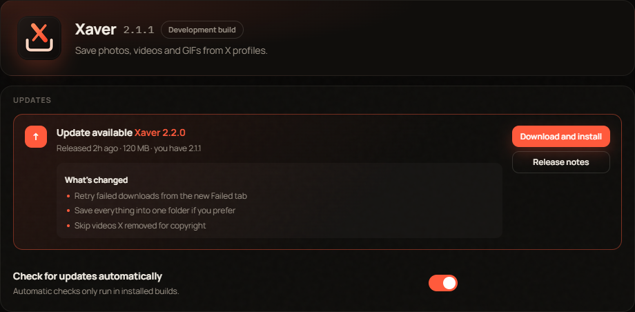

<p align="center">
  
</p>

<h1 align="center">Xaver</h1>

<p align="center">A Windows desktop app for saving photos, videos and GIFs from X profiles.</p>

<p align="center">
  <a href="https://github.com/COMPLEXWASTAKEN/xaver/releases/latest"></a>
  <a href="https://github.com/COMPLEXWASTAKEN/xaver/actions/workflows/ci.yml"></a>
  <a href="https://github.com/COMPLEXWASTAKEN/xaver/actions/workflows/codeql.yml"></a>
  
</p>

> [!WARNING]
> **This project is made with AI.** Most of the code, docs and design were written with AI coding tools and then tested and reviewed by a person. It works and it's tested before every release, but it's a hobby project, not a polished commercial product. Expect rough edges, keep backups of anything you care about, and read the code before trusting it with anything important.

<p align="center">
  
</p>

## Download

Grab **`Xaver-Setup-<version>.exe`** from the [latest release](https://github.com/COMPLEXWASTAKEN/xaver/releases/latest) and run it. It needs Windows 10 or 11, 64-bit.

The installer isn't code-signed yet, so Windows SmartScreen may warn you. Choose **More info**, then **Run anyway**. Every release lists SHA-256 checksums if you want to check the file first.

Once it's installed, Xaver checks for new versions on its own and tells you when one is ready. Open **About** to download and install it in one click. Your library, settings, PIN and session are kept.

## What it does

Point it at a profile (yours or anyone's) and it scrolls through media, posts, reposts, replies, likes or highlights and collects everything it finds into a gallery. Pick what you want and save it, or save the lot.

- **Never saves the same thing twice.** Every file is hashed into a local database, so media you already have is hidden from the gallery and skipped on download. It even remembers files you've since moved or deleted, and **Find moved files** matches them up again.
- **Your folders, your way.** A new folder for every download, one folder per profile, or everything in a single folder, with photos, videos and GIFs sorted into their own subfolders or kept side by side.
- **Retry what failed.** Anything that doesn't download lands in the **Failed** tab with a preview and a plain reason (removed, no access, rate limited, timed out). Retry one, a few, or all of them. Xaver also gives failed files a second try on its own.
- **Skips takedowns.** Videos and photos X has removed for copyright or withheld never reach your gallery.
- **Real browser, real session.** Scans run through ShardX, an anti-detect Chromium build, with your own X login.
- **App lock.** Optional PIN or Windows Hello, with auto-lock when idle, when Windows locks, or when the app is minimised.
- **Privacy tools.** Hide the window from screenshots and screen sharing, blur it when you switch away, or press a panic shortcut to hide it instantly.
- **Encrypted at rest.** Settings, your session, job history, notifications and the media database are encrypted with Windows data protection and AES-256.
- **Notifications.** Windows notifications and an in-app history for finished scans, downloads, failures and updates, with quiet hours and a private mode.
- **Themes.** Five themes, any accent colour, animation levels and a first-run setup.

| | |
|---|---|
|  |  |
|  |  |
|  |  |

## Contributing

Want something added or fixed? **Open a pull request.** Pull requests are the way to get changes in. Ideas and bug reports are welcome as issues too, but a PR is the fastest route.

Read [CONTRIBUTING.md](CONTRIBUTING.md) first. The short version:

1. Fork the repo and branch off `main`.
2. Make your change, run `npm run typecheck`, and try it with `npm run dev`.
3. Open a pull request that says what changed and why, with a screenshot if it touches the UI.

CI builds and verifies every pull request automatically. No code comments, please. See [the note on comments](#a-note-on-comments).

## Running from source

You'll need Windows 10 or 11 and Node 22 or newer.

```bash
npm install
npm run dev
```

On first launch the app downloads the ShardX browser. Then open **Account**, sign in to X in the window that appears, and start a scan from the **Scan** page. You can also import a cookie export instead; see [docs/cookies.example.txt](docs/cookies.example.txt) for the format.

| Command | What it does |
|---|---|
| `npm run dev` | Run with hot reload |
| `npm run typecheck` | Type-check everything |
| `npm run build` | Build into `out/` |
| `npm run dist` | Full release build: app, installer, checks |
| `npm run dist:dir` | Unpacked app only, no installer |
| `npm run clean` | Delete build output |
| `npm run icons` | Regenerate icons from `build/icon.svg` |
| `npm run cli` | Terminal scanner that reads a cookie file |
| `npm run release` | Bump the version, tag it and push, which publishes a release |

The installer is a small WPF app in [`installer/`](installer) and needs the [.NET SDK](https://dotnet.microsoft.com/download) to build. `npm run dist:dir` skips it.

## Releases

Every push and pull request is built and verified on GitHub Actions, and each push to `main` refreshes the **Latest build** pre-release. To publish a version:

```bash
npm run release            # 2.1.1 -> 2.1.2
npm run release -- minor   # 2.1.1 -> 2.2.0
npm run release -- 2.2.0-beta.1
```

This checks that `main` is clean and up to date, bumps the version, commits, tags and pushes. The tag starts the **Release** workflow, which builds and verifies the installer and publishes it with checksums and notes made from the commits since the last tag. Versions with a suffix like `-beta.1` are marked as pre-releases, and the app's update check ignores them.

## Project layout

```
electron/
  main/        app process: window, IPC, jobs, updates, notifications, security, storage
  preload/     the bridge the UI talks to
  shared/      types used on both sides
src/           scraping engine: browser, scraping, downloads, media database
ui/            React interface: app shell, components, views, styles
installer/     custom Windows installer (C# / WPF)
scripts/       build, packaging and release tooling
docs/          screenshots and the cookie file example
```

## Where your data lives

- Settings, session, PIN, notifications and the media database are stored in `%APPDATA%\Xaver`. Installs upgraded from the old Profile Media Saver keep using their existing folder.
- Downloads go to `Documents\Xaver` by default. Change it in **Settings → General**.
- The app talks to X, to ShardX once to download its browser, to GitHub to check for updates, and to Google Fonts for the interface typeface. Nothing else.

## Security

See [SECURITY.md](SECURITY.md) for how the app is hardened and how to report a problem privately.

## A note on comments

There are no code comments in this repository, and that's on purpose. The code is meant to explain itself through clear names, small functions and a folder structure that says where things live. If something is hard to follow without a comment, that's treated as a sign the code needs reworking, not annotating.

## Use responsibly

Only save media you have the right to save, and respect X's terms and the people who post there. This project isn't affiliated with or endorsed by X Corp.

## License

Proprietary, all rights reserved. The source is public so you can read it, report problems and send pull requests, but it isn't open source. See [LICENSE](LICENSE) and [CONTRIBUTING.md](CONTRIBUTING.md).
